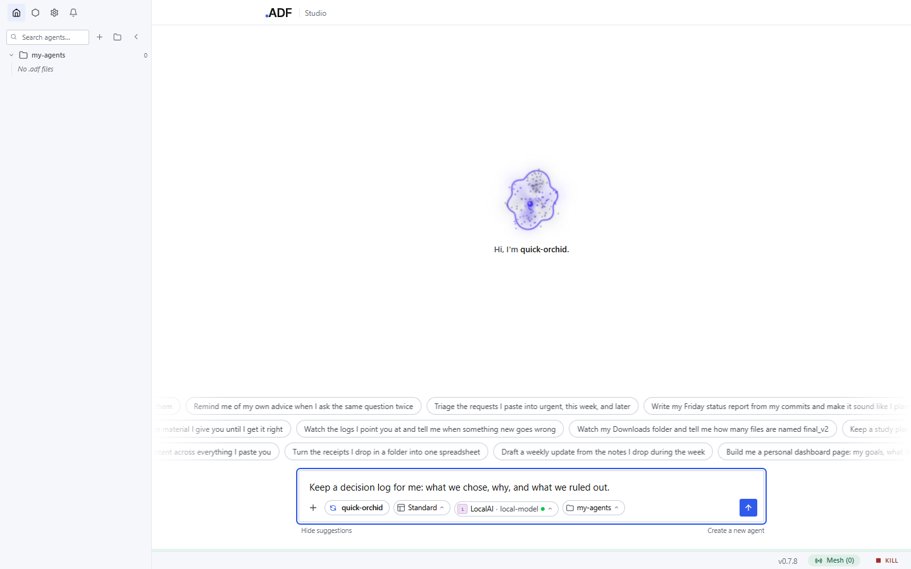
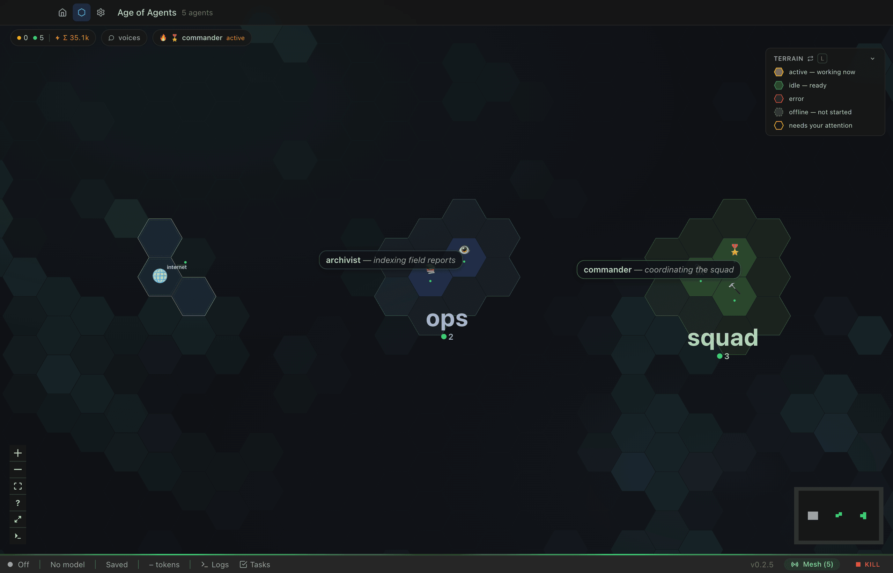
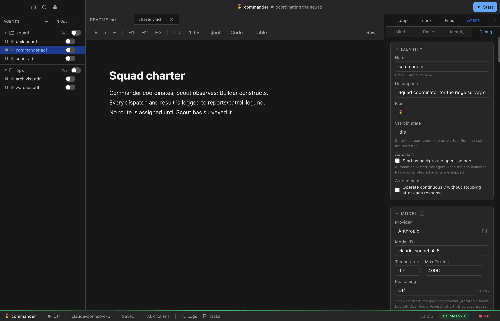

# ADF Studio

ADF Studio is the desktop application for creating, configuring, and operating ADF agents. It is the visual IDE for the [Agent Document Format](../README.md): you author a localized agent, follow its turns, configure its tools, and run it on the mesh. Each agent is one `.adf` file, its body ([what's inside](../ADF_SPEC_v0.2.md#13-one-file-one-agent)).

This document covers the **Studio application itself**: its interface, settings, and day-to-day workflows. For the underlying format, runtime, and tool concepts, see the [documentation index](index.md), which links every guide. For the headless runtime, see the [Daemon documentation](daemon/index.md).

> **Looking for a specific concept?** Start at [docs/index.md](index.md). This page is the app tour, not the full reference. It links into the guides rather than duplicating them.

---

## Installation and Prerequisites

Before you begin you need:

1. **ADF Studio** installed on your machine (macOS, Windows or Linux).
2. **At least one LLM provider**. Studio supports Anthropic, OpenAI, OpenAI-compatible endpoints, and Claude, ChatGPT and Grok subscriptions. Studio asks for one the first time you send a task from Home; see [Getting Started](getting-started.md).

On first launch Studio creates its application data directory (`~/.adf-studio/`), which holds settings, the shared sandbox-package store, and per-agent compute state.

---

## Setting Up a Provider

An agent needs a provider before it can run. Home opens the provider sheet when you send a task with none ready. To add one ahead of time:

1. Open **Settings** (the gear in the title bar, or `Cmd/Ctrl + ,`).
2. Go to **Providers**.
3. Click **Add provider**. A catalog opens with one tile per service, grouped as:
   - **Subscriptions**: ChatGPT Plus/Pro and SuperGrok/X Premium, via OAuth sign-in (flat-rate, no API key); Claude Pro/Max, signed in through your installed Claude Code (2.1.248 or newer), drawing on the plan's limits.
   - **APIs**: Anthropic, OpenAI, OpenRouter, Gemini, xAI, Mistral, Groq and the other hosted endpoints (API key).
   - **Local**: LM Studio, Ollama, vLLM, llama.cpp and others, with the usual localhost base URL prefilled.
   - **Other**: any endpoint that speaks the OpenAI API, with a base URL you enter.
4. Click a tile. The provider is created and its configure modal opens: enter the key or complete the sign-in, optionally set a default model, and **Save**.

Provider keys are application-level and are **never** exposed to agent code execution; only server-side model invocation can use them. See [Settings](guides/settings.md#providers) for the full provider reference.

---

## Anatomy of the Interface

The main window has five areas:

- **Title bar** (top): app navigation on the left, the open agent in the middle, its run control on the right.
- **Sidebar** (left): your tracked folders and the agents in them.
- **Center**: Home, the Mesh view, Settings, or the open agent's editor tabs.
- **Dock** (right): the open agent's panels. Shown only while an agent is on screen.
- **Status bar** (bottom): the open agent's save state, model and context, the Logs and Tasks toggles, the version, and the runtime's mesh and **Kill**.

Every icon-only control shows its name as a tooltip on hover, with its keyboard shortcut when it has one.

### Title bar

Left to right, the navigation group lines up with the sidebar:

| Control | What it does |
|---------|--------------|
| **Home** | Shows Home. Home only navigates: the open agent stays open. |
| **Mesh** | Opens the [Mesh view](#the-mesh-view). |
| **Settings** | Opens [Settings](#settings). |
| **Notifications** (bell) | Every pending approval and question across all agents and loops. A badge counts the pending ones; protection requests carry an **override** badge. An approval can be approved or rejected in place, and each item jumps to its agent. |
| Open agent's avatar | Shown while an agent is open, after a divider. Lit while the agent's views are on screen; from Home, the Mesh view or Settings it returns to the agent. |

The middle shows the open agent's avatar, its name (with `•` while it has unsaved changes), its state dot, and what its main loop is doing: the reason of the current tool call while it is active, or the agent's own status text once it settles. With no agent open, or on Home, it shows the ADF wordmark and **Studio**.

The right end holds:

- **Open in new window**: opens the agent in a window of its own. Not offered with **Inside Studio (legacy)** in [Connections](guides/settings.md#connection).
- **Start** while the agent is off, or **Off** while it runs. **Off** ends the running turn at once, stops the agent's host shells and unloads the agent. To end only the turn, use **Stop** in the composer (see [Talking to Your Agent](#talking-to-your-agent)).

**Close Agent** (File menu, `Cmd/Ctrl + Shift + W`) closes the open agent.

### Sidebar

The header row has **Search agents…**, **New agent** (`+`), **Open agent or track folder** (a folder button with **Open agent…** and **Track folder…**) and **Collapse sidebar**. Collapsed, the sidebar is a rail of avatars for the running agents and the open one.

Below the header:

- **Running**: a collapsible list of the running agents, with a count.
- One section per tracked folder, as a tree. A folder row has **Start all** or **Stop all**. Right-click it for **Rescan**, **Show in Explorer** (**Reveal in Finder** on macOS) and **Untrack folder…**.

An agent row shows, left to right:

- the avatar with its state dot. An amber ring means the agent is waiting on you; the tooltip says **Waiting for your approval** or **Has a question for you**;
- the agent's file name, with a small count when inner loops are working;
- **Not reviewed** (a shield with `!`): the agent, for example a file someone sent you, has not been reviewed yet; Studio shows the review before it starts;
- **Open in its own window** (a window glyph): the agent has a window of its own;
- a bolt for an autonomous agent;
- on hover, its messaging direction (**Sends messages**, **Receives messages**, **Sends and receives messages**);
- **Start** or **Stop**.

Right-click an agent row, or press `Shift + F10` on it, for **Start**/**Stop**, **Open in new window**, **Rename…**, **Clone…**, **Share…**, **Show in Explorer** and **Delete…**. See [Getting Started](guides/getting-started.md#sharing-an-agent) for sharing.

### The Home view

Home is what the center shows with no agent open, or after **Home**. It has:

- once agents exist, a status line: the agent count (opens the Mesh view), **running** and, when any, **failing** (each unfolds a list with **Stop** on each row), tokens today (opens Settings → Usage), any failing providers (opens Settings → Providers), and a **Mesh** button;
- a **Model provider** card while no provider is ready;
- the composer, pinned at the bottom, with chips for the new agent's name, template, provider and model, and folder.

Every message sent from Home creates a new agent, which opens with its loop in the center. [Getting Started](getting-started.md) walks through it.

### Center: editor tabs

With an agent open, the center holds its editor tabs: files from the agent's body, and the **Computer** tab for an agent with a desktop. A new agent opens with `README.md`, `mind.md` and `soul.md`, with `README.md` in front. Closing every tab leaves **No file open** with **Open core files**. See [Documents and Files](guides/documents-and-files.md).

The chat can also live here. **Open chat in center stage** in the Loops panel header moves it to a pinned **Loops** tab before the file tabs; its close button, or `Cmd/Ctrl + W` on it, puts the chat back in the dock. An agent made from Home opens this way.

### Dock

The dock has five tabs:

| Tab | What it shows |
|-----|---------------|
| **Overview** | The agent's card: avatar, name, description, state and model, four stats, Coming up, Activity and Contents. See [Agent Overview](guides/agent-overview.md). |
| **Loops** | The chat: the main loop and any inner loops, each in its own tab. Absent while the chat is in the center. |
| **Inbox** | Messages from other agents and channels, with **All**, **Unread**, **Read**, **Archived** and **Sent** filters and a search box. The tab shows the unread count. |
| **Files** | The agent's files (`adf_files`), with search, upload and **New file**. It updates as the agent writes. |
| **Agent** | Four sub-tabs: **Timers**, **Identity**, **Skills** and **Config**. |

**Collapse panel** (`Cmd/Ctrl + J`) shrinks the dock to a rail with one icon per tab and sub-tab; clicking one opens the dock on it. Drag the dock's left edge to resize it; double-click the edge to reset the width. The dock keeps its tab, sub-tab, width and collapsed state across launches. Opening another agent keeps the tab you are on. Each panel's scroll position, and the Inbox filter and search, are kept per agent while Studio runs.

### Bottom panel

**Logs** and **Tasks** in the status bar open a resizable bottom panel with those two tabs. **Logs** shows the agent's `adf_logs` with level, origin and text filters; **Live** (on by default) adds new entries every 2 seconds while the panel is open. **Tasks** shows `adf_tasks` with a status filter and its own **Live** toggle. See [Logging](guides/logging.md) and [Tasks](guides/tasks.md).

### Status bar

With an agent open, the left side shows **Saved** or **Unsaved changes** (click to save), the model of the loop on screen, and its context gauge (click for the breakdown), then **Logs** and **Tasks**. The right side shows an **Update** badge when a new version is available, the version, and the runtime group: **Mesh (N)** or **Mesh off** (click for Settings → Networking), and **Kill**, which stops every agent and the mesh.

In Local mode, with a connection saved in [Connections](guides/settings.md#connection), the runtime group is that of the open agent's runtime, or of the local runtime when no agent is open. It shows the runtime's name ([Runtime names](guides/studio-backend.md#runtime-names): *name* (Local) for this computer; a saved name with the remote icon, tooltip "Remote", for another computer; the address as tooltip; a click opens Settings → Connections), its state while it is not connected, its **Mesh** and its **Kill**. **Kill** stops the agents and the mesh of that runtime only, and is disabled while that runtime is not connected. The up arrow beside the group (tooltip "Servers"; red while another server is not connected) opens a list of every runtime, the local runtime first, then the other computers in the order they were added: each with its name, state, **Mesh** and **Kill**. **Kill all** at the top stops the agents and the mesh on every connected runtime and says what it stopped, or which runtimes it did not reach. `↑`/`↓` move between the buttons; `Esc` closes the list. An agent window shows the group of its own runtime and no arrow.

### More than one runtime

In Local mode, with a connection saved in [Connections](guides/settings.md#connection), Studio connects to the local runtime and to each saved computer at the same time. Then:

- the sidebar has one group per runtime, headed with its name and, while it is not connected, its state; that runtime's agents are greyed while it is not connected;
- **Go to Agent…** shows the runtime's name after the agent's;
- the Mesh view draws each runtime as a region, labelled with its name;
- every row in **Notifications**, every toast and every system notification names its runtime before the agent (`box-1 · agent-1`);
- an agent window's title is `<agent> · <runtime name>`;
- **File → Open Recent** lists each other computer's agents under its name;
- the **Help** menu names each runtime that is not connected, and **Reconnect** acts on it.

### Switching agents

**Go to Agent…** (View menu, `Cmd/Ctrl + K`) opens a search over every tracked agent. Each result shows its folder and, where it applies, **Open**, **Needs you** or **Running**. `↑`/`↓` move, `Enter` opens, `Esc` closes.

### The Mesh view

**Mesh** in the title bar (View → Mesh, `Cmd/Ctrl + Shift + M`) opens the Mesh view: a map where every agent is a tile on a hex territory, grouped by folder. From there you can select one or many agents, command them with keys, rearrange the map, and handle pending approvals. The view has its own top bar with the same navigation. See the [Mesh view guide](guides/fleet-map.md).

---

## Creating Your First Agent

Type a task on Home and press Enter; [Getting Started](getting-started.md) covers that flow. To make a blank agent instead:

1. Click **New agent** (`+`) in the sidebar, or File → New ADF Agent (`Cmd/Ctrl + N`).
2. Choose a file name and folder in the save dialog. The file name becomes the agent's name.
3. Studio creates the `.adf` file from the default [agent template](guides/agent-templates.md) and opens it.

A new agent gets everything in its template except the template's identity and history, including its start state, files and tool set. It gets a new 12-character config `id` and its own identity. Fields the template does not set take the [new-file defaults](../ADF_SPEC_v0.2.md#141-new-file-defaults).

See [Creating and Configuring Agents](guides/creating-agents.md) for every configuration field.

---

## Talking to Your Agent

1. Open the agent from the sidebar. The **Loops** tab (in the dock, or in the center) holds the chat.
2. Type in the composer at the bottom and press **Enter**. `Shift + Enter` adds a line.

Sending a message drives the lifecycle:

1. The agent transitions from **idle** to **active**.
2. Its model processes your message alongside its instructions, document, and available tools.
3. It responds, possibly calling tools along the way. Each call and result is shown inline in the loop.
4. It returns to **idle**.

While a turn runs:

- A message you send is queued (**Queued (N)** above the composer). **Send now** delivers it at the agent's next step without stopping its work. A message that could not be sent shows **Not sent** with the reason, and goes first with your next message.
- **Stop** beside the send button, or `Esc` in the loop view with the composer empty, ends the turn. Text the model already streamed stays in the loop, marked as cut off.
- A gated tool call shows approve and reject controls in the loop. With two or more pending, **Review N calls** lists them and approves exactly those, each once. Protection overrides are left out of the list and decided one at a time.

The `+` in the composer, or a drop onto it, attaches files. Each attachment shows as a chip with its name and kind, and is saved in the agent's files when you send; the message keeps a reference to it (see [Multimodal](#multimodal)). A file the agent's model cannot take is refused with the reason.

See [Agent States and Lifecycle](guides/agent-states.md) for the full state model (active, idle, hibernate, suspended, off) and [Memory Management](guides/memory-management.md) for how the loop is compacted and archived over time.

---

## Configuring an Agent

Open **Agent** → **Config** in the dock. The sticky header names the section in view; click it, or press `/`, to jump to any section. Sections are grouped:

| Group | Sections |
|-------|----------|
| Base | Identity, Model, Instructions, Context |
| Capabilities | Tools, Loops, Code Execution, Compute, MCP Servers |
| Communication | Channels, Messaging, Security, Serving, WebSocket Connections, Stream Bindings |
| Automation | Triggers, Hooks, Umbilical Taps |
| Records | Logging, Metadata, Meta Keys |

Sections that do not apply to the agent are not listed. Each tool row in **Tools** has a lock (**Locked**: the agent cannot change it), **Needs approval** (an agent call waits for you), **Visible** (shown to the model) and an enabled checkbox; see [Tools](guides/tools.md#enabling-and-disabling-tools). **Restricted** marks what only authorized code can call or write, such as restricted code-execution methods and protected tables. `mind.md` and `soul.md` are edited as files in the editor, not here.

Every field is documented in [Creating and Configuring Agents](guides/creating-agents.md).

---

## Settings

Settings (the gear in the title bar, or `Cmd/Ctrl + ,`) replaces the sidebar with its own navigation: **Back to app**, **Search settings**, then two groups.

- **Studio**, this app on this computer: **Appearance**, **Notifications**, **Updates**, **Privacy**, **About**, **Connections**. In Studio a runtime is an agent server (the ADF daemon). **Connections** has one **Add** at the top, then **Local server** (*name* (Local): its state, **Details**, and **Keep running after Studio quits**), **Remote servers** (the saved connections, each with **Remove** in its **More** menu) and **Devices** (the devices that can access the local server, each with **Revoke**). **Add** offers two cards: **Connect** ("Connect to a remote agent server.": a server found on the network or an address, then a code or a token, all on one form) and **Share** ("Share this server.": the name devices see, consent with one **Allow**, a 6-digit code, the addresses with **Copy**) ([Connections](guides/settings.md#connection)).
- The runtime's pages: **Prompts**, **Agent templates**, **Providers**, **Packages**, **MCP servers**, **Skills**, **Channels**, **Files**, **Identity**, **Networking**, **Compute**, **Usage**. **Networking** is agent messaging: a status card with **Allow** for the current network, **Sharing** (**Mesh**, **Network**, **Agents**), **Networks**, **Servers** and **Advanced** ([Networking](guides/settings.md#networking)). With the local server only, this group has no heading. With a connection saved in **Connections**, it is headed **Server** with a picker of the server names, and these pages show the server picked there. Each of these pages shows a header strip with "Server" and the picked server's icon and name. Settings opens on the runtime of the open agent (from an agent window: that window's runtime), else the local runtime; the choice is not saved. A picked runtime that is not connected shows "Not connected to *name*." and its controls are disabled. The **Studio** pages do not change with the picker.

Settings save as you change them; **Saved** shows in the page header when a write lands, and a refused write shows **Not saved:** with the reason. The complete reference, including the save rules, is in [Settings](guides/settings.md).

---

## Multimodal

Studio agents can perceive images, audio, and video when the matching modality is enabled in the agent's `model.multimodal` configuration. Media is always a file in `adf_files`: chat attachments, files the agent reads with `fs_read` or `cat`, and MCP tool media. The message or tool result keeps a `file_ref` reference to the file (ADF spec §13.1). Each request loads the referenced files and sends them as native content blocks when the modality is enabled; otherwise it sends a text placeholder. History keeps the reference either way, so turning a modality on later, or switching back to a model that takes it, sends the older media again. See [Media when changing models](cli/models-and-providers.md#media-when-changing-models) for the placeholders, the request media limit and deleted files.

The request media limit is the **Media** field in Config → Context: the most files and MB one request carries (default 20 files, 20 MB). Past either, the oldest files are left out and the chat says how many.

| Modality | Config flag | Content block | Supported formats | Default size limit (`limits.*`) |
|----------|-------------|---------------|-------------------|--------------------------------|
| **Image** | `multimodal.image` | `image_url` | PNG, JPEG, GIF, WEBP | `max_image_size_bytes` (5 MB) |
| **Audio** | `multimodal.audio` | `input_audio` | WAV, MP3, OGG, FLAC, AAC, AIFF, M4A, WebM | `max_audio_size_bytes` (10 MB) |
| **Video** | `multimodal.video` | `video_url` | MP4, MPEG, QuickTime, WebM | `max_video_size_bytes` (20 MB) |

Notes:

- **Image** replaces the legacy `model.vision` toggle.
- **Audio**: the AI SDK natively supports only WAV and MP3; other formats are coerced to WAV for the SDK's validator while actual codec negotiation happens provider-side.
- **Video**: the AI SDK has no native video support, so the runtime injects raw OpenAI-format `video_url` parts directly into the request body. This works for providers that accept the OpenAI chat-completions format (OpenRouter, Gemini, etc.).
- Media content blocks are **ephemeral**: they are not persisted to `adf_loop`.
- **In code/shell execution**, the full structured JSON (with raw base64 data) is always returned regardless of these settings, so agents can parse, transform, save (`fs_write`), or forward media programmatically. See [The adf Proxy Object](guides/adf-object.md) and [Tools](guides/tools.md#filesystem-tools).

---

## Keyboard Shortcuts

**Help → Keyboard Shortcuts** lists every shortcut, including the Mesh view's keys. The main ones:

| Shortcut | Action |
|----------|--------|
| `Cmd/Ctrl + K` | Go to agent |
| `Cmd/Ctrl + N` | New agent |
| `Cmd/Ctrl + O` | Open agent file |
| `Cmd/Ctrl + Shift + O` | Track folder |
| `Cmd/Ctrl + Shift + N` | Open in new window |
| `Cmd/Ctrl + Shift + W` | Close agent |
| `Cmd/Ctrl + S` | Save |
| `Cmd/Ctrl + W` | Close the active tab (on the center **Loops** tab: put the chat back in the dock) |
| `Cmd/Ctrl + Shift + H` | Home |
| `Cmd/Ctrl + Shift + M` | Mesh |
| `Cmd/Ctrl + Shift + E` | Toggle sidebar |
| `Cmd/Ctrl + J` | Toggle panel (the dock) |
| `Cmd/Ctrl + ,` | Settings |
| `Esc` | In the loop view: stop the running turn |
| `/` | In Config: jump to a section |
| `Shift + F10` | On a sidebar row: its actions |

---

## Where to Go Next

- [Getting Started](getting-started.md): create your first agent and start a conversation.
- [Core Concepts](guides/core-concepts.md): one file, one agent; the access boundary; the ADF stack.
- [Documentation index](index.md): the full list of guides for the format, runtime, tools, messaging, security, and more.
- [Daemon documentation](daemon/index.md): run the same `.adf` agents headlessly via the API runtime.
